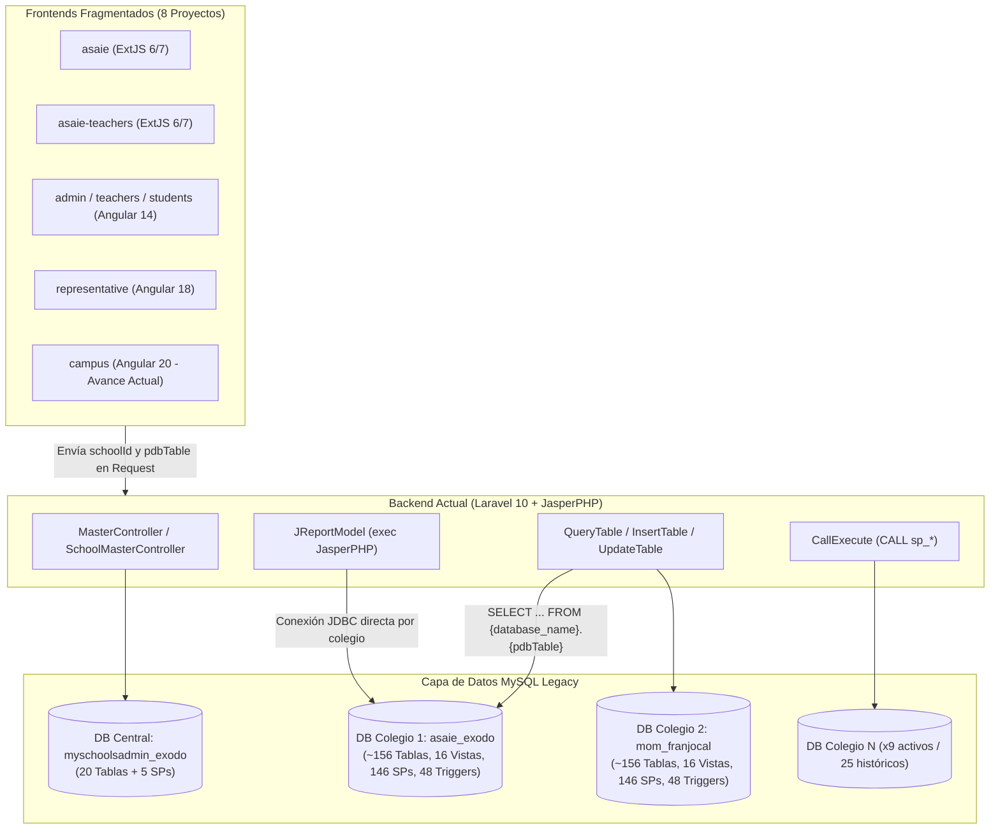
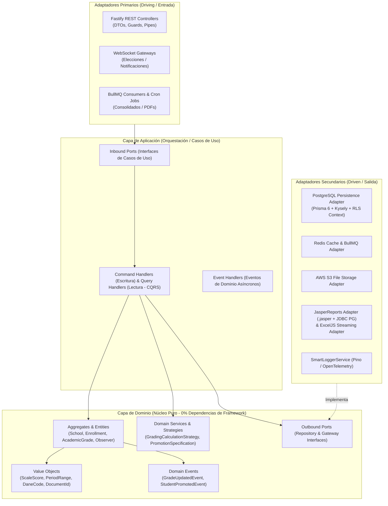
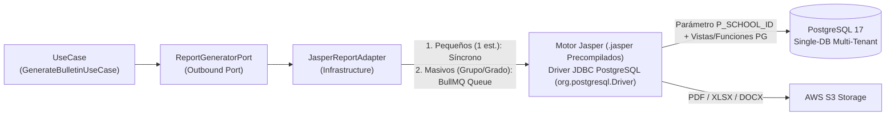
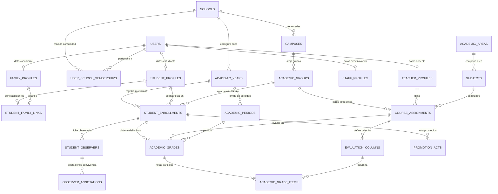
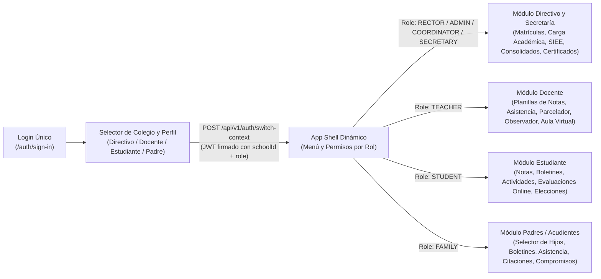
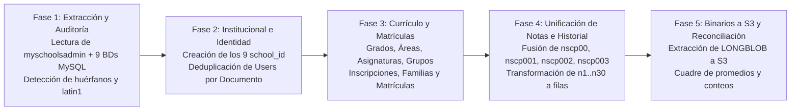

# Informe Maestro de Arquitectura, Diagnóstico de Base de Datos y Plan de Migración — ASAIE ÉXODO (SaaS Multi-Tenant)

- **Fecha y Hora de Creación:** 2026-11-05 10:30 (America/Bogota)
- **Versión:** 1.1.0
- **Autor:** Arquitecto Cloud & Desarrollador FullStack Senior
- **Estado:** Arquitectura Aprobada con Continuidad de JasperReports, Aislamiento de Directorios/Rama y Docker Local Híbrido

---

## 1. Resumen Ejecutivo

El sistema **ASAIE ÉXODO** ha operado históricamente bajo un esquema **Multi-Database (una base de datos MySQL por institución educativa más una base de datos central `myschoolsadmin_exodo`)**, acompañado de múltiples aplicaciones frontend fragmentadas (Sencha ExtJS 6/7, Angular 14, Next.js, Angular 18 y un avance reciente en Angular 20 bajo `fronts/campus`) y un backend en Laravel 10 que ejecuta consultas directas y procedimientos almacenados sobre esquemas dinámicos.

Esta arquitectura generó una fricción operativa crítica:
1. **Imposibilidad de mantenimiento escalable:** Actualizar una tabla, vista, trigger o procedimiento almacenado implicaba aplicar scripts manuales (`db/cambios*.sql`, `backend/database/Scripts/2022..2025/*.sql`) en decenas de bases de datos independientes, provocando desincronización de esquemas (*Schema Drift*).
2. **Impacto directo en el negocio:** La dificultad para desplegar mejoras continuas y corregir errores causó la pérdida de más de 20 instituciones educativas (de las 25 registradas históricamente en `myschoolsadmin_exodo.schools`), permaneciendo actualmente **9 colegios activos** que requieren migración inmediata.
3. **Cuellos de botella de rendimiento y seguridad:** Consultas dinámicas cruzando bases de datos, tablas divididas por nivel educativo (`nscp00`, `nscp001`, `nscp002`, `nscp003`), desnormalización severa (`n1..n30`, `ar1..ar25`), 48 triggers síncronos y 146 procedimientos almacenados por colegio.

### Solución Estratégica Seleccionada
Se diseña una **modernización integral (Re-architecting & Migration)** hacia una plataforma **SaaS Educativa Multi-Tenant de Base de Datos Única en PostgreSQL 17**, con cada institución identificada mediante una llave primaria única auto-incremental (`school_id`), respaldada por un **Backend en NestJS 11 + Fastify 5** bajo **Arquitectura Hexagonal (Ports & Adapters) + DDD Táctico**, y un **Frontend Unificado en Angular 20+** (evolucionando el paso ya iniciado en `fronts/campus`) para toda la comunidad educativa: **Directivos, Administrativos, Docentes, Estudiantes y Padres/Acudientes**.

---

## 2. Diagnóstico Técnico del Sistema Actual (Legacy)

### 2.1. Análisis de la Topología Dual-DB Actual

El sistema actual divide la persistencia en dos motores lógicos sobre MySQL/MariaDB:



#### A. Base de Datos Central (`myschoolsadmin_exodo` — 27 Objetos DDL)
Almacena el catálogo de colegios (`schools`), usuarios globales (`users`), perfiles (`user_profiles`), roles por colegio (`user_roles`, `school_users`, `school_teachers`), módulos contratados (`system_modules`, `school_modules`), auditoría básica (`tb_audit`), archivos (`file_managers`), tablas OAuth2 de Laravel Passport (`oauth_*`) y catálogos geográficos (`countries`, `departments`, `cities`).

**Problemas detectados en `myschoolsadmin_exodo`:**
- **Procedimientos con cursores y SQL dinámico entre bases de datos:** Procedimientos como `sp_select_all_students`, `sp_select_all_students_out` y `sp_select_all_teachers` abren un `CURSOR` sobre la tabla `schools`, concatenan cadenas `UNION SELECT ... FROM <db>.matriculas` y ejecutan `PREPARE` (incluso con errores de columna como `SELECT t.database FROM schools` cuando la columna real es `database_name`).
- **Agotamiento de conexiones:** Existencia del procedimiento `sp_kill_sleeping_connections` que recorre `information_schema.PROCESSLIST` ejecutando `KILL` sobre conexiones inactivas >59 segundos, síntoma directo de fugas de conexión y bloqueos por consultas no optimizadas.

#### B. Base de Datos por Colegio (`asaie_exodo` / `mom_franjocal` — ~495 Objetos DDL por Colegio)
Cada base de datos de colegio contiene:
- **~156 Tablas físicas**
- **16 Vistas (`nscp00*_view_*`)**
- **146 Procedimientos Almacenados (`sp_*`)**
- **18 Funciones Almacenadas (`fn_*`)**
- **48 Triggers (`BEFORE/AFTER INSERT/UPDATE/DELETE`)**

---

### 2.2. Hallazgos Críticos en el Diseño de la Base de Datos Actual

| # | Categoría de Anomalía | Evidencia en Esquema Actual (`asaie_exodo.sql` / `mom_franjocal`) | Impacto Técnico y de Negocio |
| :- | :--- | :--- | :--- |
| **1** | **Particionamiento Manual por Tablas (Anti-patrón Sharding por Nivel)** | Notas divididas en 4 tablas idénticas: `nscp00` (Preescolar), `nscp001` (Primaria, ~625k filas), `nscp002` (Secundaria, ~1.12M filas), `nscp003` (Media, ~436k filas). Igual ocurre con `nscp00*_promedio_notas` (x4), `log_nscp00*` (x4), `sug_nscp00*` (x4), `preinforme_nscp00*` (x4) y vistas `nscp00*_view_*` (x16). | Obliga al código (`TablesQuery::getTableNotes($grade)`) y a las funciones SQL (`fn_return_table_notas`) a decidir dinámicamente a qué tabla apuntar según el grado. Impide llaves foráneas limpias y consultas globales por estudiante. |
| **2** | **Violación Severa de 1NF (Grupos Repetitivos de Columnas)** | - Tablas `nscp00*` y `backup_notes` tienen **30 columnas de notas fijas** (`n1`, `n2`, ..., `n30`).<br>- Tablas `consolidado`, `consolidado_areas`, `consolidado_docentes`, `consolidado_totales`, `sabanas`, `asig_perdidas`, `asig_perdidas_est` y `asperdidas` tienen **25 pares de columnas estáticas** (`ar1`/`nar1` ... `ar25`/`nar25`).<br>- `estadistica_edades` tiene columnas `e1` a `e19`.<br>- `obs_items_modelo_3` tiene `n1..n4`, `av1..av4`, `cs1..cs4`, `s1..s4`. | Desperdicio masivo de almacenamiento, rigidez ante cambios pedagógicos, y necesidad de ejecutar procedimientos pesados de pre-llenado (`sp_generar_consolidados`, `sp_generate_sabanas`) antes de visualizar reportes. |
| **3** | **Proliferación de Tablas por Colegio para el Observador del Estudiante** | Existen **5 estructuras de tablas diferentes** para el mismo concepto de Observador: `obs_observador_mod_1`, `obs_observador_mod1` (GEGOPEL), `obs_observador_mod2` (INESAT), `obs_observador_mod_3` (INESAT) y `obs_observer_mod_5` (FRANJOCAL). | Cada vez que un colegio requería campos distintos en su ficha de observador, se creaban tablas y procedimientos nuevos en el motor, haciendo inviable un producto SaaS estándar. |
| **4** | **Tablas Duplicadas (Español vs Inglés / Legacy vs Nuevo)** | - **Geografía duplicada 3 veces:** `myschoolsadmin_exodo.countries/departments/cities`, `asaie_exodo.countries/departments/cities` y `asaie_exodo.paises/departamentos/ciudades`.<br>- **Evaluaciones duplicadas:** `te_evaluaciones`, `te_preguntas`, `te_respuestas` vs `te_evaluations`, `te_evaluation_questions`, `te_evaluation_answers`.<br>- **Elecciones duplicadas:** `tp_candidatos`, `tp_mesas_votacion`, `tp_votos` vs `tp_candidates`, `tp_polling_stations`, `tp_votes`.<br>- **Relaciones rotas:** FK apuntando a tablas inexistentes o legadas como `cursos_old`, `matriculas_old`, `parcelador_old`. | Confusión en el mantenimiento, inconsistencia referencial y peso innecesario en la base de datos. |
| **5** | **Almacenamiento de Binarios (`LONGBLOB`) en Base de Datos** | Tablas como `doc_digitales_est` (`documento LONGBLOB`), `obs_modelos_observador_cuerpo` (`foto LONGBLOB`), `tp_jurados` (`foto LONGBLOB`), `tp_voto_blanco` (`foto LONGBLOB`) y `escudo` (`BLOB`). | Infla el tamaño de cada base de datos a >200 MB, degrada la memoria caché de consultas y hace lentos los respaldos y restauraciones. |
| **6** | **Lógica de Negocio Oculta en 48 Triggers y 146 SPs** | Los triggers `nscp00*_after_insert` y `nscp00*_after_update` ejecutan cálculos en cascada por cada fila modificada; `config_columns_theacher` acumula >2.3 millones de registros en un solo colegio generados por triggers al insertar cursos. | Bloqueos de tabla (*Lock Contention*) en cierres de periodo cuando decenas de docentes califican simultáneamente. |
| **7** | **Inconsistencia de Collations y Nombres con Caracteres Especiales** | Mezcla de `latin1_swedish_ci`, `latin1_spanish_ci`, `utf8mb3_general_ci` y `utf8mb4_unicode_ci`. Uso de la letra `ñ` en nombres de tablas/columnas/funciones (`año`, `enseñanza`, `area_enseñanza`, `desempeños`, `cdesempeños`, `fn_Getdesempeño`). | Errores de codificación de caracteres (`utf8_encode` en PHP) y problemas de portabilidad entre sistemas operativos y ORMs modernos. |

---

### 2.3. Diagnóstico de Seguridad y Rendimiento en el Código Actual

1. **Acceso Arbitrario a Tablas y Fuga de Esquema (`SchoolMaster.php` y `QueryTable.php`):**
   - El frontend envía `pdbTable` (nombre físico de la tabla en BD) y `schoolId` por parámetro HTTP.
   - `QueryTable::query()` ejecuta `SHOW COLUMNS FROM $table` y luego realiza un `SELECT ... WHERE $field LIKE '%$query%' LIMIT 1` dentro de un bucle `foreach` por cada columna de la tabla para adivinar en qué columna buscar. Esto produce $O(C)$ consultas secuenciales con *Full Table Scan* por cada petición de búsqueda.
2. **Cambio de Rol/Colegio en Cliente sin Validación de Servidor (`fronts/campus/src/app/services/auth.service.ts`):**
   - El método `setActiveSchool()` modifica directamente `localStorage` (`currentRole`, `school.database_name`) simulando asincronía con `of(null).pipe(delay(250))`, sin emitir un JWT firmado por el backend que certifique la pertenencia del usuario a ese colegio y rol.
3. **Generación de Reportes Acoplada a `exec()` y JDBC (`JReportModel.php`):**
   - Por cada reporte PDF/Excel se invoca un proceso externo de sistema operativo (`JasperPHP`) compilando `.jrxml` en tiempo de ejecución y pasando usuario/contraseña de MySQL por línea de comandos.

---

## 3. Arquitectura Objetivo y Justificación del Stack Tecnológico

### 3.1. Decisiones de Stack Tecnológico (Elegidas y Justificadas)

No se dejan decisiones abiertas; a continuación se define y justifica cada componente del nuevo ecosistema tecnológico:

| Capa | Tecnología Elegida | Versión | Justificación Arquitectónica y de Negocio |
| :--- | :--- | :--- | :--- |
| **Runtime & Lenguaje** | **Node.js LTS + TypeScript (Strict Mode)** | Node 22 LTS / TS 5.8 | Tipado estático de extremo a extremo (compartiendo contratos con Angular), ecosistema maduro y modelo de E/S no bloqueante ideal para alta concurrencia en cierres de notas y votaciones escolares. |
| **Framework Backend** | **NestJS + Fastify Adapter (`@nestjs/platform-fastify`)** | NestJS 11 / Fastify 5 | NestJS provee Inyección de Dependencias empresarial, modularidad e integración nativa con Arquitectura Hexagonal y DDD. **Fastify** reemplaza a Express ofreciendo hasta **2.5x–3x más peticiones por segundo (RPS)**, menor consumo de RAM y serialización JSON acelerada por esquemas. |
| **Motor de Base de Datos** | **PostgreSQL** | **PostgreSQL 17** | Superioridad absoluta para **Single-DB Multi-Tenant de alto volumen**: soporte nativo de **Row-Level Security (RLS)** para aislamiento estricto por colegio, **Particionamiento Declarativo** para millones de registros de calificaciones, **JSONB indexado (GIN)** para observadores dinámicos, **Vistas Materializadas Concurrentes** para consolidados y **Full-Text Search** en español. |
| **ORM y Acceso a Datos** | **Prisma ORM + Kysely (Query Builder Tipado)** | Prisma 6 + Kysely 0.27 | **Prisma 6** ofrece migraciones deterministas, seguridad de tipos absoluta y *Client Extensions* ideales para inyectar el contexto `school_id` (RLS) automáticamente. **Kysely** complementa los adaptadores de lectura (CQRS Queries) para reportes analíticos complejos (sábanas, puestos, promedios ponderados) con SQL 100% tipado y cero sobrecarga de hidratación de objetos. |
| **Caché, Sesiones y Colas** | **Redis + BullMQ (`@nestjs/bullmq`)** | Redis 7.4 / BullMQ 5 | Manejo de *Refresh Tokens* revocables, caché distribuido de configuraciones escolares/escalas de notas, y colas de trabajo asíncronas en segundo plano para generación masiva de boletines, cierres de periodo y notificaciones sin bloquear las peticiones HTTP. |
| **Autenticación y Autorización** | **Passport JWT (EdDSA / RS256) + CASL** | `@nestjs/jwt` + `@casl/ability` | Tokens JWT firmados asimétricamente que contienen `sub` (`userId`), `schoolId` activo y `roles` verificados en servidor. **CASL** permite control de acceso combinado **RBAC + ABAC** (ej. un Docente solo puede modificar notas de sus `courseAssignmentIds` activos y dentro de fechas de cierre abiertas). |
| **Motor de Reportes (PDF / Excel)** | **JasperReports (`.jrxml` / `.jasper` precompilados con JDBC PostgreSQL) + ExcelJS** | JasperReports 6.21 / ExcelJS 4 | **Preserva el 100% de la inversión en las ~100 plantillas `.jrxml` y subreportes existentes** (boletines carta/oficio, preescolar, certificados, actas, observadores, carnés). Se elimina la recompilación en cada petición de `JasperPHP` usando archivos `.jasper` precompilados conectados a PostgreSQL (`org.postgresql.Driver`) con aislamiento por `P_SCHOOL_ID` y colas asíncronas en BullMQ. |
| **Almacenamiento de Archivos** | **AWS S3 (o Cloudflare R2 compatible S3)** | AWS SDK v3 | Erradica los `LONGBLOB` de la base de datos. Todas las fotos de estudiantes, firmas escaneadas, documentos de matrícula y evidencias de tareas se suben vía **Presigned URLs** organizadas bajo el prefijo `schools/{schoolId}/{year}/{category}/{uuid}.ext`. |
| **Comunicación en Tiempo Real** | **NestJS WebSockets (`@nestjs/platform-socket.io`) + Redis Adapter** | Socket.IO 4.8 | Actualización en tiempo real del escrutinio en **Elecciones Escolares (Personero/Contralor)**, notificaciones de actividades en línea y progreso de generación de consolidados/boletines. |
| **Framework Frontend** | **Angular (Copia independiente de `fronts/campus` en `v3-frontend/`)** | **Angular 20+** | Se consolida un **único proyecto Angular 20+** en un directorio totalmente independiente (`v3-frontend/`), copiando la base de `fronts/campus` para evolucionarla sin afectar el mantenimiento de los sistemas actuales. |
| **Validación y Documentación API** | **Zod / `class-validator` + OpenAPI 3.1 (Swagger / Scalar)** | OpenAPI 3.1 | Validación estricta de DTOs de entrada (White-listing) y generación automática de contratos OpenAPI consumibles por el frontend Angular. |

---

## 4. Arquitectura de Software: Hexagonal (Ports & Adapters) + DDD + SOLID + Patrones de Diseño

### 4.1. Arquitectura Hexagonal (Ports & Adapters) y Modular Monolith

Para garantizar independencia tecnológica, alta cohesión, bajo acoplamiento y facilidad de pruebas unitarias, el backend en **NestJS + Fastify** se estructura como un **Monolito Modular con Arquitectura Hexagonal Estricta** dividido en *Bounded Contexts* (Contextos Delimitados de DDD).



#### Estructura de Directorios del Backend (`backend-nestjs/`)
Siguiendo **Regla 4 (Todo identificador técnico en código en INGLÉS)**:

```text
src/
├── main.ts                                      # Bootstrap de NestJS con FastifyAdapter
├── app.module.ts
├── shared/                                      # Kernel Compartido (Shared Kernel)
│   ├── domain/
│   │   ├── aggregate-root.base.ts
│   │   ├── entity.base.ts
│   │   ├── value-object.base.ts
│   │   ├── domain-event.base.ts
│   │   └── exceptions/
│   │       ├── domain.exception.ts
│   │       └── resource-not-found.exception.ts
│   ├── application/
│   │   ├── ports/
│   │   │   ├── logger.port.ts
│   │   │   ├── storage.port.ts
│   │   │   └── report-generator.port.ts
│   │   └── context/
│   │       └── tenant-context.service.ts        # AsyncLocalStorage para schoolId y userId
│   └── infrastructure/
│       ├── logging/
│       │   └── smart-logger.service.ts          # Regla 4: Único logger autorizado (cero console.log)
│       ├── database/
│       │   ├── prisma.service.ts                # Prisma Client con extensión RLS (app.current_school_id)
│       │   └── kysely.service.ts                # Consultas analíticas tipadas
│       ├── http/
│       │   ├── filters/global-exception.filter.ts
│       │   ├── interceptors/tenant-context.interceptor.ts
│       │   └── interceptors/audit-log.interceptor.ts
│       └── security/
│           ├── jwt-auth.guard.ts
│           └── policies.guard.ts                # CASL Authorization Guard
└── modules/                                     # Bounded Contexts (Módulos de Dominio)
    ├── tenant/                                  # Gestión de Colegios (Schools), Sedes, Jornadas, Años Lectivos
    ├── iam/                                     # Usuarios, Membresías Multi-Colegio, Roles y Permisos (Comunidad Educativa)
    ├── curriculum/                              # Niveles, Grados, Áreas, Asignaturas, Escalas, Competencias, Logros
    ├── enrollment/                              # Inscripciones, Matrículas, Familias/Acudientes, Libros y Folios
    ├── grading/                                 # Notas, Nivelaciones, Consolidados, Cuadro de Honor, Promoción
    │   ├── domain/
    │   │   ├── entities/academic-grade.entity.ts
    │   │   ├── value-objects/score.vo.ts
    │   │   ├── strategies/                      # Strategy Pattern para cálculo de notas
    │   │   │   ├── grading-calculation.strategy.ts
    │   │   │   ├── weighted-competency.strategy.ts
    │   │   │   ├── simple-average.strategy.ts
    │   │   │   └── preschool-qualitative.strategy.ts
    │   │   ├── specifications/                  # Specification Pattern para promoción escolar
    │   │   │   └── student-promotion.specification.ts
    │   │   └── ports/
    │   │       └── academic-grade.repository.port.ts
    │   ├── application/
    │   │   ├── commands/record-student-grades.use-case.ts
    │   │   └── queries/get-consolidated-grades.query.ts
    │   └── infrastructure/
    │       ├── persistence/prisma-academic-grade.repository.ts
    │       └── http/grading.controller.ts
    ├── coexistence/                             # Asistencia, Observador Dinámico (JSONB), Seguimiento Disciplinario
    ├── virtual-classroom/                       # Parcelador, Plan Semanal, Actividades, Evaluaciones Online, Clases en Vivo
    ├── school-government/                       # Elecciones Estudiantiles (Personero, Contralor, Consejo)
    └── reporting/                               # Boletines, Certificados, Constancias, Carnés QR, Sábanas Excel
```

---

### 4.2. Aplicación Rigurosa de Principios SOLID y Clean Code

1. **Single Responsibility Principle (SRP):**
   - En el sistema legado, `SchoolMaster` y `JReportModel` resolvían el colegio, validaban datos, construían SQL dinámico, compilaban reportes Jasper, subían archivos a S3 y guardaban en base de datos.
   - En la nueva arquitectura, cada **Caso de Uso (`UseCase`)** tiene una única razón para cambiar (ej. `RecordStudentGradesUseCase` solo coordina el registro de notas; `GeneratePeriodicBulletinUseCase` solo orquesta la generación del boletín delegando el renderizado PDF a `ReportGeneratorPort` y el almacenamiento a `StoragePort`).
2. **Open/Closed Principle (OCP):**
   - Cada colegio en Colombia (según el Decreto 1290 del MEN) define su propio Sistema Institucional de Evaluación de Estudiantes (SIEE): algunos califican por promedio aritmético de notas, otros por porcentaje de competencias (Saber, Hacer, Ser), otros por dimensiones en preescolar, y algunos aprueban el área si el promedio ponderado de sus asignaturas supera la nota mínima (`config001.porcentaje_areas`, `fail_subject_of_the_area`).
   - Mediante interfaces de estrategia (`GradingCalculationStrategy` y `PromotionRuleSpecification`), agregar una nueva regla de calificación o promoción consiste en crear una nueva clase que implemente la interfaz sin modificar el motor de evaluación existente.
3. **Liskov Substitution Principle (LSP):**
   - Cualquier implementación de `StoragePort` (`S3StorageAdapter` en producción o `MinioLocalStorageAdapter` en desarrollo) o de `AcademicGradeRepositoryPort` (`PrismaAcademicGradeRepository` o `InMemoryAcademicGradeRepository` en tests unitarios) es 100% intercambiable sin alterar el comportamiento del caso de uso.
4. **Interface Segregation Principle (ISP):**
   - Se eliminan interfaces monolíticas como la antigua `CrudInterface` (donde `Master.php` debía lanzar `throw new Exception("No implements")` en `create`, `update` y `delete` porque solo leía datos). Se segregan puertos específicos de lectura y escritura (`ReadOnlyCatalogRepositoryPort` vs `WriteEnrollmentRepositoryPort`).
5. **Dependency Inversion Principle (DIP):**
   - La capa de Dominio y Aplicación nunca importa `@prisma/client`, `fastify` ni `aws-sdk`. Define **Puertos (`Ports` como `abstract class` o `InjectionToken`)** y la capa de Infraestructura inyecta los **Adaptadores (`Adapters`)** a través del contenedor IoC de NestJS.

---

### 4.3. Catálogo de Patrones de Diseño Aplicados

| Patrón de Diseño | Categoría | Problema del Sistema Actual que Resuelve | Implementación en la Nueva Arquitectura |
| :--- | :--- | :--- | :--- |
| **Strategy** | Comportamiento | Lógica condicional `if/else` en decenas de procedimientos almacenados (`sp_prom_por_area`, `sp_prom_por_area_porcentaje`, `sp_prom_por_area_quinta`) según `config001`. | `GradingCalculationStrategy` selecciona en tiempo de ejecución el algoritmo de cálculo de definitivas de asignatura y área según el `SchoolGradingConfig` del colegio. |
| **Specification** | Dominio (DDD) | Procedimientos rígidos para definir quién aprueba, reprueba o habilita el año escolar (`sp_acta_promo_estadistica`, `fn_GetEstadoFinalEst`) y cierres de fecha (`ControlClosingDates`). | Especificaciones componibles (`AndSpecification`, `OrSpecification`): `PeriodOpenForTeacherSpec`, `StudentEligibleForPromotionSpec`, `StudentCanVoteInStationSpec`. |
| **CQRS (Command Query Responsibility Segregation)** | Arquitectónico | Tablas de escritura (`nscp00*`) y tablas pre-calculadas de lectura (`consolidado*`, `sabanas`) acopladas mediante triggers lentos en cada `INSERT/UPDATE`. | Separación de **Commands** (validados por entidades de dominio y persistidos vía Prisma) y **Queries** (consultas de lectura directa sobre vistas materializadas e índices vía Kysely). |
| **Observer / Domain Events** | Comportamiento / DDD | 48 triggers en MySQL (`nscp001_after_update`, `registration_novelties_after_insert`) que ralentizan las transacciones y ocultan efectos secundarios. | Cuando se confirma una calificación, el Agregado emite `StudentGradeRecordedEvent`; un manejador asíncrono en BullMQ actualiza el promedio del área, el puesto del grupo y la vista materializada de consolidados. |
| **Factory Method & Builder** | Creacional | 29 clases en `app/Reports/*.php` concatenando parámetros `SQL_PARAM` para JasperReports. | `ReportDocumentFactory` y `BulletinReportBuilder` que ensamblan los bloques del reporte (encabezado institucional, escudo, tabla de áreas/asignaturas, indicadores de desempeño, inasistencias, firmas digitales y código QR de verificación). |
| **Repository & Unit of Work** | Estructural / Persistencia | Consultas `DB::table("{$school->database_name}.{$pdbTable}")` dispersas en controladores y modelos. | Repositorios por Agregado que encapsulan la persistencia y ejecutan operaciones multi-tabla dentro de una transacción atómica con contexto RLS (`school_id`). |
| **Decorator / Interceptor** | Estructural | Llamadas manuales a `AuditTable::audit($ip, $tb, 'UPDATE', $data)` dentro de helpers de consulta. | `@Auditable('ENROLLMENT_UPDATED')` + `AuditLogInterceptor` que registra automáticamente el `beforeState`, `afterState`, `userId`, `schoolId`, `ipAddress` y `userAgent` de forma asíncrona. |

---

### 4.4. Continuidad y Modernización de JasperReports (`.jrxml` / `.jasper`) en NestJS + PostgreSQL

El proyecto actual cuenta con **~100 plantillas y subreportes en `backend/public/reports/`** diseñadas en Jaspersoft Studio (`boletin_carta_areas.jrxml`, `boletin_oficio_areas_comp.jrxml`, `boletin_carta_preescolar.jrxml`, `certificado_estudio_real.jrxml`, `actas_promocion_final.jrxml`, `ficha_obs_mod3.jrxml`, `carnets.jrxml`, etc.). **Sí podemos y debemos seguir usando JasperReports**, corrigiendo los cuellos de botella de cómo se invocaba en Laravel (`JReportModel.php`):

#### Diagnóstico de qué hacía lento a Jasper en el Backend Legacy (`JReportModel.php`)
1. **Doble arranque de JVM en frío por cada reporte:** En `JReportModel::getReportExport()` se ejecutaba `$jasper->compile($reportName.'.jrxml')->execute()` en cada petición HTTP y luego `$jasper->process(...)`. Levantar dos máquinas virtuales de Java desde cero por cada petición consumía entre **3 y 8 segundos** antes siquiera de consultar la base de datos.
2. **Inyección de consultas por parámetro (`$P!{SQL_PARAM}`) sin aislamiento:** Las plantillas ejecutaban directamente la cadena recibida en `SQL_PARAM` (`CALL sp_boletines_reportes(...)`) y los subreportes hacían `SELECT * FROM encabezado_reportes LIMIT 1` asumiendo que cada colegio tenía su propia base de datos física.

#### Arquitectura del Nuevo `JasperReportAdapter` en NestJS (`v3-backend`)


1. **Copia Independiente de Plantillas (`v3-backend/resources/reports/`):**
   - Se copian todos los `.jrxml` y subreportes hacia `v3-backend/resources/reports/` sin modificar los de `backend/public/reports/`.
2. **Cero Compilación en Tiempo de Ejecución:**
   - Un script de construcción (`npm run reports:compile`) compila todos los `.jrxml` a binarios `.jasper` una sola vez. En producción y desarrollo, el adaptador ejecuta directamente el archivo `.jasper` precompilado.
3. **Adaptación Transparente a PostgreSQL Single-DB Multi-Tenant:**
   - El adaptador pasa a JasperReports el driver nativo de PostgreSQL (`driver: 'postgres'`, `org.postgresql.Driver`) apuntando a la base de datos única en PostgreSQL 17.
   - Se inyecta siempre el parámetro obligatorio `P_SCHOOL_ID` (obtenido del JWT validado en servidor, nunca del cliente).
   - En PostgreSQL se crean **Vistas y Funciones de Compatibilidad para Reportes** (por ejemplo, `fn_report_periodic_bulletins(p_school_id, ...)` y vistas filtradas por RLS como `vw_report_school_header`) que retornan **exactamente los mismos nombres de columnas (`fields`)** que ya esperan los `.jrxml` (`estudiante`, `area`, `asignatura`, `final`, `conceptual`, `ih`, `p1..p4`, `ar`, etc.). De esta forma, **no hay que rediseñar la maquetación visual de los ~100 reportes**.
4. **Desacoplamiento con Colas en Redis (BullMQ) para Reportes Masivos:**
   - Cuando un coordinador o secretaria solicita los boletines o certificados de un grupo o grado completo, Fastify responde en `<50 ms` con un `jobId`, el worker de **BullMQ** procesa el reporte en segundo plano usando `JasperReportAdapter`, sube el resultado a S3 y notifica en tiempo real al navegador en Angular mediante WebSockets.

---

## 5. Diseño Detallado de la Nueva Base de Datos Unificada en PostgreSQL

### 5.1. Estrategia Multi-Tenant con Identificador Único Auto-Incremental por Colegio

Cumpliendo estrictamente la directriz del proyecto:
> *"Ya no tendríamos DB dispersas para cada colegio sino que todo estaría en una misma DB y cada escuela tendría su identificador único auto-incrementable."*

1. **Tabla Maestra `schools` con ID Auto-Incremental (`BIGINT GENERATED ALWAYS AS IDENTITY`):**
   - Cada colegio recibe un identificador entero auto-incremental único (`id = 1, 2, ..., 9, 10...`).
   - Todas las tablas operativas poseen la columna `school_id BIGINT NOT NULL` referenciando a `schools(id)`.
2. **Aislamiento Garantizado por Row-Level Security (RLS) en PostgreSQL:**
   - Al iniciar cada petición HTTP o Job en NestJS, el `PrismaService` abre el contexto de base de datos ejecutando:
     ```sql
     SELECT set_config('app.current_school_id', $1::text, true);
     ```
   - Todas las tablas con `school_id` tienen habilitado `ALTER TABLE <table_name> ENABLE ROW LEVEL SECURITY;` con una política restrictiva que impide leer o escribir filas cuyo `school_id` no coincida con `current_setting('app.current_school_id')::bigint`. Así, incluso ante un error humano al escribir una consulta, **es físicamente imposible que un colegio vea o altere datos de otro colegio**.
3. **Índices Compuestos Tenant-First:**
   - Todo índice primario de búsqueda e índice de unicidad de negocio inicia con `school_id` (por ejemplo: `UNIQUE (school_id, academic_year, enrollment_number)`), permitiendo a PostgreSQL hacer *Index-Only Scans* acotados exclusivamente al sub-árbol B-Tree del colegio activo.

---

### 5.2. Solución a los Problemas Históricos del Esquema Legacy

#### A. Eliminación de las 4 Tablas de Notas (`nscp00..nscp003`) y de las 30 Columnas (`n1..n30`)
En lugar de tener 4 tablas por nivel educativo con 30 columnas fijas (`n1..n30`), 4 tablas de promedios, 4 tablas de logros, 4 tablas de sugerencias y 4 tablas de preinformes (**20 tablas en total solo para notas**), el nuevo diseño las unifica en **3 tablas relacionales limpias y particionadas**:
1. **`academic_grades`**: Un registro por `(school_id, academic_year, enrollment_id, course_assignment_id, academic_period_id)` que almacena la nota definitiva del periodo (`final_score`), la nota de nivelación (`remedial_score`), el desempeño alcanzado (`performance_level_id`), las inasistencias (`justified_absences`, `unjustified_absences`, `tardies`) y la observación de preinforme.
2. **`academic_grade_items`**: Almacena cada calificación parcial individual asociada a una columna de evaluación o competencia (`academic_grade_id`, `evaluation_column_id`, `score`), reemplazando las 30 columnas `n1..n30` y la tabla gigante `config_columns_theacher`.
3. **`academic_grade_feedbacks`**: Unifica `log_nscp00*` y `sug_nscp00*` vinculando `academic_grade_id` con los logros/indicadores o sugerencias pedagógicas asignadas al estudiante en ese periodo.

#### B. Eliminación de las 9 Tablas Desnormalizadas de Consolidados y Sábanas (`ar1..ar25`)
Se eliminan por completo las tablas `consolidado`, `consolidado_areas`, `consolidado_docentes`, `consolidado_totales`, `consolidado_areas_totales`, `sabanas`, `asig_perdidas`, `asig_perdidas_est` y `asperdidas`.
En PostgreSQL 17, los consolidados por asignatura, por área y los puestos estudiantiles se resuelven mediante:
- Funciones de ventana nativas de PostgreSQL (`AVG()`, `SUM()`, `RANK() OVER (PARTITION BY school_id, academic_group_id, academic_period_id ORDER BY weighted_average DESC)`).
- Una **Vista Materializada (`mv_student_period_summaries`)** con índice único que se refresca concurrentemente (`REFRESH MATERIALIZED VIEW CONCURRENTLY`) sin bloquear lecturas.

#### C. Unificación del Observador del Estudiante mediante Plantillas JSONB (`observer_templates` + `student_observers`)
Se eliminan las tablas específicas por colegio (`obs_observador_mod_1`, `obs_observador_mod1`, `obs_observador_mod2`, `obs_observador_mod_3`, `obs_observer_mod_5`).
- Cada colegio puede usar la plantilla estándar o configurar su propio esquema de campos socio-familiares, antropométricos y psicopedagógicos (PIAR / barreras de aprendizaje) en `observer_templates.schema_definition (JSONB)`.
- Las respuestas de la ficha anual del estudiante se guardan validadas en `student_observers.profile_data (JSONB)` indexadas con `GIN`, y el historial de anotaciones, descargos y compromisos de convivencia se almacena de forma relacional en `observer_annotations`.

#### D. Modelo Unificado de Comunidad Educativa (Un Solo Usuario, Múltiples Roles y Colegios)
En lugar de tener usuarios separados en `myschoolsadmin_exodo.users`, `asaie_exodo.users`, `docentes`, `inscripciones`, `families`, `administrativos`, `family_and_users_ids` y `teachers_and_users_ids`:
- Existe una única tabla `users` (identidad global de la persona con tipo y número de documento, email, credenciales seguras Argon2id y perfil base).
- La tabla `user_school_memberships` vincula a un `user_id` con uno o varios `school_id` y sus roles dentro de cada colegio (`RECTOR`, `COORDINATOR`, `SECRETARY`, `ADMIN`, `TEACHER`, `STUDENT`, `FAMILY`).
- Un mismo padre de familia que además es docente en el mismo colegio (o en otro colegio de la plataforma) inicia sesión con **una sola cuenta** y puede alternar entre su rol de **Docente** y su rol de **Acudiente** (viendo a todos sus hijos matriculados a través de `student_family_links`).

---

### 5.3. Diagrama Entidad-Relación (ERD) de la Nueva Base de Datos Unificada



---

### 5.4. Mapeo Completo de Tablas Legacy a la Nueva Estructura PostgreSQL (3NF)

Se consolidan los ~515 objetos dispersos de las dos bases de datos antiguas en **48 tablas limpias, normalizadas y tipadas en PostgreSQL**:

#### Módulo 1: Catálogos Globales y Geografía (Compartidos, sin `school_id`)
| Tabla Nueva (PostgreSQL) | Tablas Legacy Reemplazadas | Propósito y Mejoras Clave |
| :--- | :--- | :--- |
| `countries` | `myschoolsadmin.countries`, `asaie.countries`, `asaie.paises` | Catálogo ISO-3166 único de países. |
| `departments` | `myschoolsadmin.departments`, `asaie.departments`, `asaie.departamentos` | Catálogo DANE único de departamentos/estados. |
| `cities` | `myschoolsadmin.cities`, `asaie.cities`, `asaie.ciudades`, `asaie.ciudades1` | Catálogo DANE único de municipios. |
| `document_types` | `documentos`, `docdocente` | Tipos de documento (RC, TI, CC, CE, PEP, PPT, NES). |
| `health_providers` | `eps` | Catálogo nacional de EPS. |
| `ethnic_groups` | `etnias`, `resguardos` | Etnias y resguardos indígenas (SIMAT). |
| `disability_types` | `discapacidades`, `tipo_discapacidad`, `capacidades_excepcionales`, `poblacion_victima_conflicto` | Catálogos de caracterización SIMAT unificados por categoría. |

#### Módulo 2: Multi-Tenancy e Estructura Institucional (`school_id`)
| Tabla Nueva (PostgreSQL) | Tablas Legacy Reemplazadas | Propósito y Mejoras Clave |
| :--- | :--- | :--- |
| `schools` | `myschoolsadmin.schools`, `asaie.school`, `encabezado_reportes`, `escudo`, `firmas` | **`id BIGINT GENERATED ALWAYS AS IDENTITY PRIMARY KEY`**. Unifica datos del colegio, código DANE, NIT (`tax_id`), logos en S3, estado de suscripción (`lock_date`, `is_active`) y configuración general. |
| `school_modules` | `myschoolsadmin.system_modules`, `myschoolsadmin.school_modules`, `access_modules` | Módulos y *feature flags* activos por institución. |
| `campuses` | `sedes`, `jornadas_sedes`, `niveles_sedes`, `myschoolsadmin.study_levels`, `infraes` | Sedes educativas del colegio (`school_id`), dirección, zona (urbana/rural), código DANE de sede y metadatos de infraestructura en JSONB. |
| `school_shifts` | `jornadas`, `jornadas_sedes` | Jornadas habilitadas por sede (Mañana, Tarde, Nocturna, Única, Fin de Semana). |
| `academic_years` | `config001`, `cierre`, `config_matricula_enlinea` | Configuración anual por colegio (`school_id`, `year`, estado abierto/cerrado, reglas de redondeo, decimales, porcentaje de inasistencia, reglas de promoción del SIEE). |
| `academic_periods` | `periodos_academicos` | Periodos académicos por año lectivo y grupo de grados, con fechas de apertura/cierre de notas ordinarias y de nivelación. |

#### Módulo 3: Identidad, Acceso y Comunidad Educativa (IAM)
| Tabla Nueva (PostgreSQL) | Tablas Legacy Reemplazadas | Propósito y Mejoras Clave |
| :--- | :--- | :--- |
| `users` | `myschoolsadmin.users`, `asaie.users`, `usuarios_oficina` | Cuenta única de identidad por persona (`document_type_id`, `document_number`, `email`, `password_hash`, `first_name`, `middle_name`, `last_name`, `second_last_name`, `gender`, `birth_date`, `avatar_url`). |
| `user_school_memberships` | `school_users`, `school_teachers`, `user_roles`, `user_profiles`, `user_types`, `teachers_and_users_ids`, `family_and_users_ids` | Relación N:M entre `users` y `schools` con los roles asignados (`RECTOR`, `COORDINATOR`, `SECRETARY`, `ADMIN`, `TEACHER`, `STUDENT`, `FAMILY`) y estado activo. |
| `refresh_tokens` | `oauth_access_tokens`, `oauth_refresh_tokens`, `sessions`, `ci_sessions`, `useraces` | Control de sesiones activas, rotación de Refresh Tokens y trazabilidad de dispositivos. |
| `student_profiles` | `inscripciones`, `inscripciones_copy`, `extra_inscripciones` | Ficha socioeconómica, médica y SIMAT del estudiante asociada a `user_id` y `school_id`. |
| `teacher_profiles` | `docentes`, `aux_docentes`, `escalafon` | Datos de escalafón, especialidad, nivel de enseñanza y firma digital del docente. |
| `family_profiles` | `families`, `family_type` | Datos laborales y de contacto de padres/madres/acudientes. |
| `student_family_links` | `aux_families_students`, `family_relationships` | Vínculo entre estudiantes y sus familiares (`relationship_type`: Padre, Madre, Acudiente Legal; `is_financial_responsible`, `lives_with_student`). |
| `staff_profiles` | `administrativos`, `cargo`, `nomcargo`, `carrera_administrativa`, `vinculacion_advos` | Personal directivo y administrativo de la institución. |

#### Módulo 4: Diseño Curricular y Escalas de Valoración
| Tabla Nueva (PostgreSQL) | Tablas Legacy Reemplazadas | Propósito y Mejoras Clave |
| :--- | :--- | :--- |
| `education_levels` | `niveles_estudio`, `niveles`, `nivel`, `enseñanza` | Niveles educativos (Preescolar, Básica Primaria, Básica Secundaria, Media Académica/Técnica, Ciclos Adultos). |
| `grade_groups` | `grados_agrupados`, `aux_grados_agrupados` | Agrupaciones de grados para compartir reglas de evaluación y periodos (`config001`). |
| `grades` | `grados` | Grados escolares (-2 Párvulos, -1 Prejardín, 0 Transición, 1° a 11°, Ciclos CLEI). |
| `academic_areas` | `areas`, `areas_promocion`, `grados_areas_promocion`, `promotion_areas` | Áreas fundamentales y optativas por colegio. |
| `subjects` | `asignaturas`, `asignaturas_banco`, `aux_asignaturas`, `subject_certificates` | Asignaturas vinculadas a áreas académicas. |
| `curriculum_plans` | `matcurso` | Plan de estudios anual (`school_id`, `academic_year_id`, `grade_id`, `area_id`, `subject_id`, `weekly_hours`, `area_weight_percentage`). |
| `grading_scales` | `escala_nacional`, `desempeños`, `cdesempeños`, `valnotas` | Escala de valoración institucional por año y grupo de grados (Superior, Alto, Básico, Bajo con rangos `min_score`, `max_score` y `is_passing`). |
| `competencies` | `competencias`, `columnas_notas_competencias`, `dimensiones`, `aspectos` | Competencias o dimensiones evaluativas por año y grupo de grados, con su peso porcentual. |
| `achievement_bank` | `logros_estandares`, `banco_cli`, `sugerencias`, `procesos_educativos`, `tipo_procesos_educativos` | Banco unificado de estándares, competencias, indicadores de desempeño y sugerencias pedagógicas. |

#### Módulo 5: Matrículas, Grupos y Carga Académica
| Tabla Nueva (PostgreSQL) | Tablas Legacy Reemplazadas | Propósito y Mejoras Clave |
| :--- | :--- | :--- |
| `academic_groups` | `cursos` (parcial), `dir_grupo`, `proyeccion_cupos` | Grupos abiertos en un año lectivo (`school_id`, `academic_year_id`, `campus_id`, `shift_id`, `grade_id`, `group_code`, `director_teacher_id`, `quota`). |
| `course_assignments` | `cursos` | Carga académica: qué docente dicta qué asignatura en qué grupo (`academic_group_id`, `subject_id`, `teacher_id`, `weekly_hours`). |
| `student_enrollments` | `student_enrollment`, `pre_matricula_nuevos`, `pre_matricula_viejos`, `student_access`, `registration_status` | Matrícula anual del estudiante (`school_id`, `academic_year_id`, `student_profile_id`, `academic_group_id`, `enrollment_number`, `folio_number`, `book_number`, `status`, `permissions_json`). |
| `enrollment_novelties` | `registration_novelties`, `novedades`, `nov_inst` | Historial de novedades de matrícula (Traslado, Retiro, Deserción, Cambio de Grupo/Sede). |

#### Módulo 6: Evaluación, Calificaciones, Nivelaciones y Promoción (Particionadas)
| Tabla Nueva (PostgreSQL) | Tablas Legacy Reemplazadas | Propósito y Mejoras Clave |
| :--- | :--- | :--- |
| `evaluation_columns` | `config_columns_theacher`, `columnas_notas_competencias` | Actividades/columnas evaluativas definidas por el docente para su curso y periodo (`course_assignment_id`, `academic_period_id`, `competency_id`, `name`, `weight_percentage`). |
| `academic_grades` | **`nscp00`, `nscp001`, `nscp002`, `nscp003`**, `nscp00*_promedio_notas`, `preinforme_nscp00*`, `areasf`, `backup_notes` | **Tabla unificada y particionada**. Contiene la nota definitiva del estudiante en el curso y periodo, nota de nivelación, inasistencias y estado de preinforme. |
| `academic_grade_items` | Columnas `n1..n30` de `nscp00*` | **Tabla normalizada y particionada**. Almacena la nota obtenida por el estudiante en cada `evaluation_column_id`. |
| `academic_grade_feedbacks` | **`log_nscp00*` (x4), `sug_nscp00*` (x4)** | Indicadores de desempeño, logros y observaciones asignadas a la calificación del estudiante. |
| `remedial_acts` | `respeciales`, `recuperacionesp` | Actas de nivelación/recuperación periódica y de fin de año (`act_number`, `previous_score`, `remedial_score`, `act_date`). |
| `promotion_acts` | `acta_promocion`, `acta_promo_encabezado`, `promoted_header`, `detail_promoted`, `promoted_observation` | Actas de promoción final y anticipada, estado final del estudiante (Promovido, Reprobado, Pendiente de Nivelación) y folio del libro final de calificaciones. |

#### Módulo 7: Convivencia Escolar, Asistencia y Observador Dinámico
| Tabla Nueva (PostgreSQL) | Tablas Legacy Reemplazadas | Propósito y Mejoras Clave |
| :--- | :--- | :--- |
| `attendance_records` | `ausencias` | Control detallado de asistencia e inasistencias justificadas/injustificadas por clase y fecha. |
| `observer_templates` | `obs_modelos_observador`, `obs_modelos_observador_cuerpo`, `obs_items_modelos`, `obs_criterios` | Plantillas dinámicas del Observador configurables por colegio (`schema_definition JSONB`). |
| `student_observers` | **`obs_observador_mod_1`, `obs_observador_mod1`, `obs_observador_mod2`, `obs_observador_mod_3`, `obs_observer_mod_5`** | Ficha anual del observador del estudiante con respuestas estructuradas en `profile_data JSONB` (salud, familia, PIAR, dificultades de aprendizaje). |
| `observer_annotations` | `obs_anotaciones_mod_3`, `obs_annotations_mod_5`, `obs_items_modelo_1`, `obs_items_modelo_3`, `obs_items_modelo_obs1`, `obs_items_modelo_obs2`, `conv_control_seguimiento`, `mom_formato_evaluacion` | Anotaciones positivas, llamados de atención, situaciones Tipo I/II/III (Ley 1620), descargos del estudiante, compromisos del acudiente y firmas. |

#### Módulo 8: Aula Virtual, Planeación y Gobierno Escolar
| Tabla Nueva (PostgreSQL) | Tablas Legacy Reemplazadas | Propósito y Mejoras Clave |
| :--- | :--- | :--- |
| `lesson_plans` | `parcelador`, `parcelador_unidades`, `parcelador_con_tem`, `parcelador_items_con_tem`, `parcelador_cli`, `parcelador_cli_detalle`, `plan_semanal_clases`, `reg_actividades` | Planeador de área (parcelador) y plan semanal de clases del docente. |
| `online_activities` | `ta_online_activities`, `ta_courses_online_activities`, `ta_shared_online_activities`, `ta_online_activities_history`, `ta_comments_activities`, `material_educ`, `material_educ_compartido`, `historial_material_educ` | Tareas, guías pedagógicas, entregas de estudiantes y retroalimentación docente vinculada a una `evaluation_column_id`. |
| `online_evaluations` | `te_evaluations`, `te_evaluation_courses`, `te_evaluation_questions`, `te_evaluation_answers`, `te_shared_evaluation`, `te_evaluation_result`, `te_evaluation_response_history`, `te_evaluaciones*`, `sm_*` (Simulacros ICFES) | Motor unificado de exámenes en línea y simulacros tipo pruebas Saber/ICFES con calificación automática hacia la planilla de notas. |
| `live_classes` | `tl_live_classes`, `tl_course_live_classes`, `tl_students_live_classes`, `tl_student_live_class_history` | Programación y control de asistencia a clases sincrónicas. |
| `school_elections` | `tp_control_panel`, `tp_candidacies`, `tp_candidates`, `tp_polling_stations`, `tp_degrees_per_table`, `tp_table_headquarters`, `tp_juries`, `tp_votes`, `tp_aux_candidate_votes`, `tp_white_vote`, `tp_aux_white_vote`, `tp_panel_control`, `tp_candidatos`, `tp_mesas_votacion`, `tp_votos` | Subsistema de Gobierno Escolar (elección de Personero, Contralor, Representante Estudiantil) con voto secreto auditable y escrutinio en tiempo real. |
| `files` & `audit_logs` | `myschoolsadmin.file_managers`, `asaie.file_managers`, `doc_digitales_est`, `watermark_files`, `myschoolsadmin.tb_audit`, `asaie.auditoria` | Gestor documental centralizado en S3 y bitácora de auditoría inmutable particionada por fecha. |

---

### 5.5. DDL de Referencia en PostgreSQL 17 (Núcleo Multi-Tenant + RLS + Particionamiento)

```sql
-- =============================================================================
-- 1. TABLA MAESTRA DE COLEGIOS (ID ÚNICO AUTO-INCREMENTABLE)
-- =============================================================================
CREATE TABLE schools (
    id BIGINT GENERATED ALWAYS AS IDENTITY PRIMARY KEY,
    public_uuid UUID NOT NULL DEFAULT gen_random_uuid() UNIQUE,
    country_id INTEGER NOT NULL REFERENCES countries(id),
    city_id INTEGER NOT NULL REFERENCES cities(id),
    dane_code VARCHAR(20) UNIQUE,
    tax_id VARCHAR(30),
    name VARCHAR(250) NOT NULL,
    short_name VARCHAR(80),
    director_name VARCHAR(150),
    secretary_name VARCHAR(150),
    address VARCHAR(200),
    phones VARCHAR(100),
    email VARCHAR(150),
    website VARCHAR(150),
    logo_url TEXT,
    shield_url TEXT,
    storage_folder VARCHAR(120) NOT NULL,
    subscription_lock_date DATE NOT NULL,
    settings JSONB NOT NULL DEFAULT '{}'::jsonb,
    is_active BOOLEAN NOT NULL DEFAULT TRUE,
    legacy_db_name VARCHAR(60) UNIQUE, -- Trazabilidad para migración de los 9 colegios
    created_at TIMESTAMPTZ NOT NULL DEFAULT NOW(),
    updated_at TIMESTAMPTZ NOT NULL DEFAULT NOW()
);

CREATE INDEX idx_schools_dane_code ON schools(dane_code);
CREATE INDEX idx_schools_active ON schools(is_active) WHERE is_active = TRUE;

-- =============================================================================
-- 2. IDENTIDAD UNIFICADA PARA TODA LA COMUNIDAD EDUCATIVA
-- =============================================================================
CREATE TYPE community_role AS ENUM (
    'SUPER_ADMIN',
    'RECTOR',
    'COORDINATOR',
    'SECRETARY',
    'SCHOOL_ADMIN',
    'TEACHER',
    'STUDENT',
    'FAMILY'
);

CREATE TABLE users (
    id BIGINT GENERATED ALWAYS AS IDENTITY PRIMARY KEY,
    document_type_id SMALLINT NOT NULL REFERENCES document_types(id),
    document_number VARCHAR(30) NOT NULL,
    email VARCHAR(255),
    username VARCHAR(100) NOT NULL UNIQUE,
    password_hash VARCHAR(255) NOT NULL,
    first_name VARCHAR(60) NOT NULL,
    middle_name VARCHAR(60),
    last_name VARCHAR(60) NOT NULL,
    second_last_name VARCHAR(60),
    gender CHAR(1),
    birth_date DATE,
    phone VARCHAR(30),
    avatar_url TEXT,
    is_active BOOLEAN NOT NULL DEFAULT TRUE,
    last_login_at TIMESTAMPTZ,
    created_at TIMESTAMPTZ NOT NULL DEFAULT NOW(),
    updated_at TIMESTAMPTZ NOT NULL DEFAULT NOW(),
    UNIQUE (document_type_id, document_number)
);

CREATE TABLE user_school_memberships (
    id BIGINT GENERATED ALWAYS AS IDENTITY PRIMARY KEY,
    school_id BIGINT NOT NULL REFERENCES schools(id) ON DELETE CASCADE,
    user_id BIGINT NOT NULL REFERENCES users(id) ON DELETE CASCADE,
    role community_role NOT NULL,
    is_active BOOLEAN NOT NULL DEFAULT TRUE,
    created_at TIMESTAMPTZ NOT NULL DEFAULT NOW(),
    UNIQUE (school_id, user_id, role)
);

CREATE INDEX idx_memberships_user_school ON user_school_memberships(user_id, school_id) WHERE is_active = TRUE;

-- =============================================================================
-- 3. CALIFICACIONES UNIFICADAS Y PARTICIONADAS (REEMPLAZA nscp00..nscp003)
-- =============================================================================
CREATE TABLE academic_grades (
    id BIGINT GENERATED ALWAYS AS IDENTITY,
    school_id BIGINT NOT NULL REFERENCES schools(id),
    academic_year SMALLINT NOT NULL,
    enrollment_id BIGINT NOT NULL,
    course_assignment_id BIGINT NOT NULL,
    academic_period_id BIGINT NOT NULL,
    performance_level_id BIGINT NOT NULL,
    final_score NUMERIC(5,2) NOT NULL DEFAULT 0.00,
    remedial_score NUMERIC(5,2) NOT NULL DEFAULT 0.00,
    effective_score NUMERIC(5,2) GENERATED ALWAYS AS (
        GREATEST(final_score, remedial_score)
    ) STORED,
    justified_absences SMALLINT NOT NULL DEFAULT 0,
    unjustified_absences SMALLINT NOT NULL DEFAULT 0,
    tardies SMALLINT NOT NULL DEFAULT 0,
    pre_report_observation TEXT,
    has_pre_report_alert BOOLEAN NOT NULL DEFAULT FALSE,
    updated_by_user_id BIGINT NOT NULL,
    created_at TIMESTAMPTZ NOT NULL DEFAULT NOW(),
    updated_at TIMESTAMPTZ NOT NULL DEFAULT NOW(),
    PRIMARY KEY (school_id, academic_year, id),
    UNIQUE (school_id, academic_year, enrollment_id, course_assignment_id, academic_period_id)
) PARTITION BY RANGE (academic_year);

-- Creación de particiones por rango de año lectivo
CREATE TABLE academic_grades_historic PARTITION OF academic_grades
    FOR VALUES FROM (2000) TO (2025);
CREATE TABLE academic_grades_2025 PARTITION OF academic_grades
    FOR VALUES FROM (2025) TO (2026);
CREATE TABLE academic_grades_2026 PARTITION OF academic_grades
    FOR VALUES FROM (2026) TO (2027);
CREATE TABLE academic_grades_2027 PARTITION OF academic_grades
    FOR VALUES FROM (2027) TO (2028);

-- Índices compuestos Tenant-First para consultas de boletines y sábanas en <5ms
CREATE INDEX idx_academic_grades_lookup
    ON academic_grades (school_id, academic_year, enrollment_id, academic_period_id);
CREATE INDEX idx_academic_grades_course
    ON academic_grades (school_id, academic_year, course_assignment_id, academic_period_id);

-- =============================================================================
-- 4. POLÍTICA DE AISLAMIENTO ROW-LEVEL SECURITY (RLS) EN POSTGRESQL
-- =============================================================================
ALTER TABLE academic_grades ENABLE ROW LEVEL SECURITY;
ALTER TABLE academic_grades FORCE ROW LEVEL SECURITY;

CREATE POLICY tenant_isolation_academic_grades ON academic_grades
    USING (school_id = current_setting('app.current_school_id', true)::bigint)
    WITH CHECK (school_id = current_setting('app.current_school_id', true)::bigint);
```

---

## 6. Arquitectura del Frontend Unificado en Angular 20+

### 6.1. Consolidación sobre `fronts/campus`
Actualmente el repositorio cuenta con un paso adelantado en `fronts/campus` sobre **Angular 20.0.6** (con soporte de `@angular/ssr`, `@jsverse/transloco`, `ApexCharts`, `FullCalendar` y sistema de estilos SCSS).

En lugar de mantener aplicaciones separadas para Administrativos, Docentes, Estudiantes, Padres y Votaciones, **toda la comunidad educativa accederá a través de una única Single Page Application (SPA/SSR) en Angular 20+**, con carga perezosa (*Lazy Loading*) de módulos según el rol activo en el token JWT:



### 6.2. Directrices Técnicas Obligatorias en Angular
1. **Estado Reactivo con Angular Signals:** Uso de `signal()`, `computed()` y `resource()` / `rxResource()` para el estado de sesión, año lectivo activo, hijo seleccionado (en perfil Familiar) y planilla de calificaciones.
2. **Cero `console.log` — Uso Exclusivo de `DebugService`:** Toda traza de depuración en el frontend se canaliza a través de `DebugService`, el cual se silencia automáticamente cuando `environment.production === true` y jamás imprime tokens ni datos personales (PII).
3. **Cero Atributo Nativo `title` — Uso Exclusivo de `[appCustomTooltip]`:** Cumpliendo las directrices de calidad visual y accesibilidad, ningún template HTML usará `title="..."`, `[title]` ni `[attr.title]`. Se utilizará siempre `CustomTooltipDirective` (`[appCustomTooltip]`) validado en CI mediante `node scripts/check-native-title.js`.
4. **Arquitectura Limpia de Estilos SCSS:** Reutilización y extensión del sistema de variables existente en `fronts/campus/src/assets/scss/variables/_variables.scss` y `_dark.scss`, prohibiendo colores *hardcodeados* en componentes.

---

## 7. Estrategia de Migración de Datos (ETL) para los 9 Colegios Activos

La migración de los **9 colegios activos** desde MySQL (`myschoolsadmin_exodo` + las 9 bases de datos individuales) hacia la base de datos única en **PostgreSQL 17** es el factor crítico de éxito para retener a los clientes actuales sin pérdida de información histórica (algunos colegios tienen historial desde el año 2002 hasta 2026).

### 7.1. El Reto de Colisión de Llaves Primarias y su Solución
En el esquema antiguo, el colegio A (`asaie_exodo`) tiene un estudiante con `inscripciones.id = 150` y una matrícula `student_enrollment.id = 4200`, y el colegio B (`mom_franjocal`) también tiene un estudiante distinto con `inscripciones.id = 150` y `student_enrollment.id = 4200`.

Para fusionar los 9 colegios en una sola base de datos sin colisiones y manteniendo el 100% de integridad referencial:
1. Se crea en PostgreSQL una tabla de trazabilidad de migración:
   ```sql
   CREATE TABLE migration_id_mappings (
       school_id BIGINT NOT NULL,
       entity_name VARCHAR(60) NOT NULL,
       legacy_id BIGINT NOT NULL,
       new_id BIGINT NOT NULL,
       PRIMARY KEY (school_id, entity_name, legacy_id)
   );
   ```
2. Cada registro insertado en PostgreSQL genera un nuevo `id` auto-incremental y registra su equivalencia `(school_id, 'student_enrollment', legacy_id) -> new_id`, permitiendo resolver todas las llaves foráneas de notas, observadores, nivelaciones y actas de promoción con exactitud matemática.

### 7.2. Pipeline ETL Automatizado en 5 Fases (Idempotente y Auditable)



1. **Fase 1 — Perfilamiento y Limpieza de Codificación:**
   - Conversión de cadenas corruptas en `latin1_swedish_ci` / `utf8mb3` a `UTF-8` puro.
   - Normalización de documentos de identidad y correos por defecto (`correo@correo.com` -> `NULL`).
2. **Fase 2 — Migración de Colegios (`schools`) y Unificación de Identidades (`users`):**
   - Se insertan los 9 colegios activos en `schools`, obteniendo sus `id` auto-incrementales (`1..9`).
   - Se consolidan docentes (`docentes`), estudiantes (`inscripciones`), familiares (`families`) y administrativos (`administrativos`) en la tabla global `users` cruzando por `(document_type_id, document_number)`, y se crean sus membresías en `user_school_memberships`.
3. **Fase 3 — Estructura Académica, Planes de Estudio y Matrículas Históricas:**
   - Migración de sedes (`sedes` -> `campuses`), jornadas, niveles, áreas (`areas`), asignaturas (`asignaturas`), planes de estudio (`matcurso` -> `curriculum_plans`), cargas académicas (`cursos` -> `academic_groups` + `course_assignments`) y matrículas (`student_enrollment` -> `student_enrollments`).
4. **Fase 4 — Fusión de las 4 Tablas de Notas (`nscp00..nscp003`) y Observadores (`obs_*`):**
   - Un worker en Node.js lee en *streaming* `nscp00`, `nscp001`, `nscp002` y `nscp003` de cada colegio, inserta las cabeceras en `academic_grades` usando `COPY` de PostgreSQL, y convierte únicamente las columnas `n1..n30` que tengan valor `> 0` en filas dentro de `academic_grade_items`.
   - Las fichas de observador (`obs_observador_mod_1..5`) se transforman al formato JSONB estandarizado en `student_observers`.
5. **Fase 5 — Extracción de Binarios a S3 y Verificación Automática (Reconciliación):**
   - Los campos `LONGBLOB` (`doc_digitales_est`, escudos, firmas) se suben a S3 y se guarda su URL en `files`.
   - Un script de validación automática compara por cada uno de los 9 colegios:
     - Total de estudiantes matriculados por año y sede (`MySQL == PostgreSQL`).
     - Promedio general y nota definitiva de muestra aleatoria de 1,000 estudiantes por colegio (`MySQL == PostgreSQL`).
     - Total de actas de promoción y certificados emitidos (`MySQL == PostgreSQL`).

---

## 8. Aislamiento de Rama Git, Separación de Directorios y Entorno Local Híbrido (Docker)

### 8.1. Regla de Oro: Cero Afectación al Sistema Actual en Producción
El sistema actual debe continuar recibiendo soporte y mantenimiento evolutivo o correctivo para los colegios activos mientras avanza la migración. Por lo tanto:
1. **Rama Git Dedicada:** Todo el trabajo de la nueva arquitectura vive en una rama independiente (`feat/v3-nestjs-postgres-migration`), sin alterar las ramas de mantenimiento actual.
2. **Separación Física de Directorios:** Los directorios actuales (`backend/`, `fronts/`, `db/`, `documentacion/`) permanecen **100% intactos**. La nueva plataforma se aloja en tres directorios nuevos en la raíz del repositorio:

```text
d:/wamp64/www/asaieexodo/
├── backend/                     # [INTOCABLE] Backend Legacy Laravel 10 + MySQL (Mantenimiento actual)
├── fronts/                      # [INTOCABLE] Frontends Legacy y fronts/campus original
├── db/                          # [INTOCABLE] Backups y scripts SQL MySQL
├── docs/                        # Documentación arquitectónica fechada
│
├── v3-infra/                    # [NUEVO] Infraestructura Docker local (SOLO PostgreSQL 17 + Redis 7.4)
│   ├── docker-compose.yml       # Contenedores exclusivos de Base de Datos y Gestión de Colas
│   ├── .env.example             # Variables de entorno para los contenedores de infraestructura
│   └── postgres/
│       └── init/
│           └── 01-extensions.sql # Habilitación de pgcrypto, unaccent, pg_trgm
│
├── v3-backend/                  # [NUEVO] Backend NestJS 11 + Fastify 5 (Corre nativo en Host local)
│   ├── prisma/                  # Esquema unificado PostgreSQL 17 + Migraciones + Políticas RLS
│   ├── resources/
│   │   └── reports/             # Copia aislada de los ~100 .jrxml / .jasper adaptados a PostgreSQL
│   └── src/                     # Código fuente en Arquitectura Hexagonal (Ports & Adapters)
│
└── v3-frontend/                 # [NUEVO] Frontend Angular 20+ Unificado (Copia aislada de fronts/campus)
    ├── scripts/
    │   └── check-native-title.js # Validador obligatorio de [appCustomTooltip]
    └── src/                     # SPA/SSR para toda la Comunidad Educativa (Corre nativo en Host local)
```

---

### 8.2. Estrategia de Dockerización Local Híbrida (DB y Colas en Docker / Apps en Host)

Para maximizar la velocidad de desarrollo, depuración paso a paso y *Hot-Reload* instantáneo:
- **SÍ se dockeriza en local (`v3-infra/docker-compose.yml`):**
  1. **Base de Datos (`asaie-v3-postgres`):** Imagen oficial `postgres:17-alpine` expuesta en `127.0.0.1:5432`, con volumen persistente y configuración optimizada para alto volumen de datos.
  2. **Gestión de Colas y Caché (`asaie-v3-redis`):** Imagen oficial `redis:7.4-alpine` expuesta en `127.0.0.1:6379` con persistencia AOF activada, utilizada por **BullMQ** (`@nestjs/bullmq`) para gestionar las colas de generación de reportes Jasper, cálculo de consolidados, envíos masivos y caché de sesión.
- **NO se dockeriza en local (Ejecución Nativa en Host):**
  1. **`v3-backend` (NestJS + Fastify):** Se ejecuta directamente en el sistema operativo local (`npm run start:dev` con compilador SWC en milisegundos) conectándose a `localhost:5432` y `localhost:6379`.
  2. **`v3-frontend` (Angular 20+):** Se ejecuta directamente en el sistema operativo local (`ng serve`) con *Hot Module Replacement (HMR)* nativo sin la penalización de I/O de volúmenes Docker en Windows.

#### Especificación de Referencia para `v3-infra/docker-compose.yml`
```yaml
name: asaie-v3-local-infra

services:
  postgres:
    image: postgres:17-alpine
    container_name: asaie-v3-postgres
    restart: unless-stopped
    ports:
      - "${POSTGRES_PORT:-5432}:5432"
    environment:
      POSTGRES_USER: ${POSTGRES_USER:-asaie_admin}
      POSTGRES_PASSWORD: ${POSTGRES_PASSWORD:-asaie_local_secret_2026}
      POSTGRES_DB: ${POSTGRES_DB:-asaie_v3_unified}
      TZ: America/Bogota
    volumes:
      - postgres_v3_data:/var/lib/postgresql/data
      - ./postgres/init:/docker-entrypoint-initdb.d:ro
    command:
      - "postgres"
      - "-c"
      - "max_connections=200"
      - "-c"
      - "shared_buffers=256MB"
      - "-c"
      - "work_mem=16MB"
    healthcheck:
      test: ["CMD-SHELL", "pg_isready -U $${POSTGRES_USER:-asaie_admin} -d $${POSTGRES_DB:-asaie_v3_unified}"]
      interval: 10s
      timeout: 5s
      retries: 5

  redis:
    image: redis:7.4-alpine
    container_name: asaie-v3-redis
    restart: unless-stopped
    ports:
      - "${REDIS_PORT:-6379}:6379"
    command: ["redis-server", "--appendonly", "yes", "--maxmemory", "512mb", "--maxmemory-policy", "noeviction"]
    volumes:
      - redis_v3_data:/data
    healthcheck:
      test: ["CMD", "redis-cli", "ping"]
      interval: 10s
      timeout: 5s
      retries: 5

volumes:
  postgres_v3_data:
    name: asaie_v3_postgres_data
  redis_v3_data:
    name: asaie_v3_redis_data
```

> [!IMPORTANT]
> En Redis se configura `--maxmemory-policy noeviction` porque es requisito obligatorio de **BullMQ** para garantizar que ningún trabajo encolado (generación de boletines en Jasper, cierre de periodo o migración) sea descartado bajo presión de memoria.

---

## 9. Metodología Ágil SCRUM y Roadmap de Ejecución

### 9.1. Marco Operativo SCRUM
- **Duración de Sprints:** 2 semanas (10 días hábiles por Sprint).
- **Artefactos:**
  - *Product Backlog* priorizado por impacto en la retención de los 9 colegios activos.
  - *Sprint Backlog* con historias de usuario técnicas y funcionales estimadas en puntos de historia (Fibonacci).
  - *Incremento Potencialmente Desplegable* al final de cada Sprint.
- **Definition of Done (DoD):**
  1. Código escrito en inglés (identificadores) siguiendo Clean Code, SOLID y Arquitectura Hexagonal.
  2. Cobertura de pruebas unitarias $\ge 80\%$ en la capa de Dominio y Aplicación (Vitest / Jest).
  3. Política RLS de PostgreSQL activa y probada con test de integración de aislamiento Multi-Tenant.
  4. Cero uso de `console.log` (validado con ESLint) y cero uso de `title` nativo en Angular (validado con `node scripts/check-native-title.js`).
  5. Documentación OpenAPI actualizada y compilación limpia (`npm run build`).

### 9.2. Plan de Entregas por Sprints (6 Épicas / 12 Sprints)

| Épica | Sprints | Entregables Clave de Valor Funcional |
| :--- | :---: | :--- |
| **Épica 1: Fundación Cloud, Infraestructura Local (`v3-infra`), Base de Datos Unificada e IAM Multi-Tenant** | **Sprints 1 – 2** | - Creación de la rama independiente, copia aislada de `fronts/campus` a `v3-frontend/`, inicialización de `v3-backend/` (**NestJS 11 + Fastify 5**) y `v3-infra/` (Docker PostgreSQL 17 + Redis 7.4 para BullMQ).<br>- Esquema base en **PostgreSQL 17** con **RLS** activo y `SmartLoggerService`.<br>- Módulo **IAM** completo: Login único, cambio de contexto (`schoolId` + `role`) firmado en servidor, gestión de sedes, años lectivos y periodos.<br>- Integración del App Shell de `v3-frontend` (Angular 20) con el nuevo flujo JWT. |
| **Épica 2: Currículo, SIEE, Matrículas y Núcleo Familiar** | **Sprints 3 – 4** | - Gestión de Áreas, Asignaturas, Plan de Estudios (`curriculum_plans`), Escalas de Valoración, Competencias y Banco de Logros.<br>- Módulo de Inscripciones, Matrículas en línea y presencial, generación de Ficha de Matrícula y vinculación de Padres/Acudientes (`student_family_links`). |
| **Épica 3: Motor de Calificaciones, Nivelaciones y Consolidados (CQRS)** | **Sprints 5 – 6** | - Carga académica docente y dirección de grupo.<br>- Planilla de calificación rápida para docentes (con autoguardado, cálculo por `Strategy Pattern` según el SIEE del colegio, registro de inasistencias y logros).<br>- Nivelaciones periódicas y finales (`remedial_acts`), Vistas Materializadas de Consolidados, Cuadro de Honor y Puestos. |
| **Épica 4: Adaptador JasperReports en PostgreSQL + Colas BullMQ + ExcelJS** | **Sprints 7 – 8** | - Implementación de `JasperReportAdapter` en `v3-backend` reutilizando las ~100 plantillas `.jrxml` / `.jasper` precompiladas en `v3-backend/resources/reports/` sobre PostgreSQL.<br>- Creación de las vistas/funciones de compatibilidad en PostgreSQL con `P_SCHOOL_ID` para Boletines Periódicos y Finales, Certificados, Constancias, Libro Final, Actas de Promoción y Carnés, procesados mediante colas en **BullMQ + Redis**. |
| **Épica 5: Convivencia, Observador Dinámico, Aula Virtual y Elecciones** | **Sprints 9 – 10** | - Observador del Estudiante dinámico con plantillas `JSONB` (soportando todos los formatos de los 9 colegios sin crear tablas nuevas) y seguimiento Ley 1620.<br>- Parcelador, Plan Semanal, Actividades en Línea, Evaluaciones Online / Simulacros ICFES.<br>- Módulo de Gobierno Escolar (Votaciones de Personero/Contralor con resultados en vivo por WebSockets). |
| **Épica 6: Pipeline ETL de los 9 Colegios, Pruebas de Carga y Puesta en Producción** | **Sprints 11 – 12** | - Ejecución y reconciliación del **Pipeline ETL** con los datos reales de los 9 colegios activos.<br>- Pruebas de carga (k6 / Postman Performance) simulando cierre de periodo concurrente de los 9 colegios.<br>- Cutover a producción y apagado definitivo del servidor MySQL/Laravel legado. |

---

## 10. Conclusión Arquitectónica

La migración hacia **NestJS + Fastify** (`v3-backend/`), **PostgreSQL 17 (Single-DB Multi-Tenant con `school_id` auto-incremental y RLS)** + **Redis / BullMQ** (`v3-infra/`), **JasperReports modernizado sobre PostgreSQL** y **Angular 20 Unificado** (`v3-frontend/`) erradica de raíz la causa por la cual se perdieron más de 20 colegios en el pasado: **a partir de esta arquitectura, desplegar una mejora funcional, una corrección normativa del MEN o un ajuste en una plantilla `.jrxml` tomará un único despliegue automatizado (`git push` -> CI/CD) y estará disponible instantáneamente tanto para los 9 colegios migrados como para 100+ colegios nuevos sin crear ni mantener bases de datos adicionales, y sin interrumpir el mantenimiento del sistema legado actual.**
